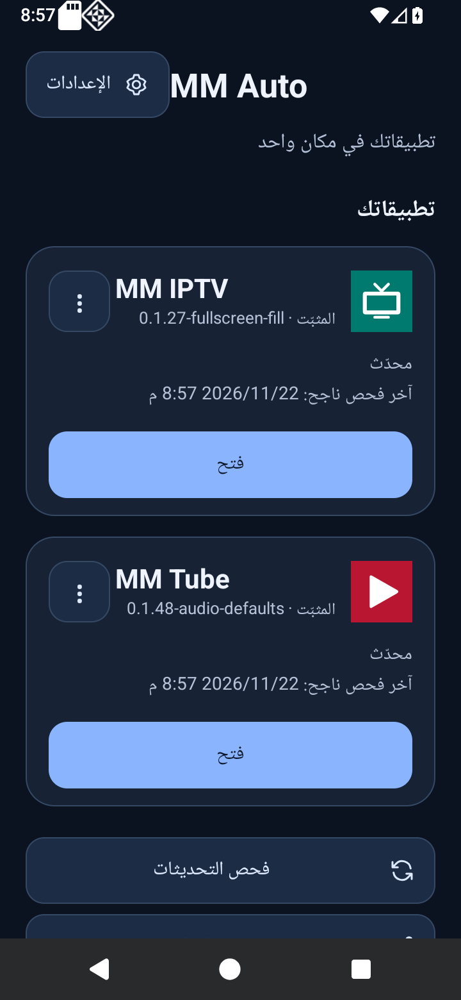
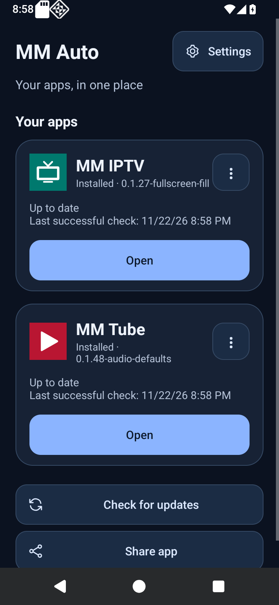

# MM Auto

[English](README.md) · **[تحميل MM Auto](https://github.com/moustafamagdi/MM-Auto/releases/latest)**

ثبّت وحدّث وأدر تطبيقَي MM Tube وMM IPTV من مكان واحد على موبايلك.

| الواجهة العربية | الواجهة الإنجليزية |
| --- | --- |
|  |  |

## المميزات

- تثبيت MM Tube وMM IPTV أو تحديثهما وفتحهما.
- معرفة التطبيقات التي تحتاج تحديثًا، مع الاحتفاظ بنتيجة آخر فحص ناجح.
- إشعارات اختيارية عند وجود تحديثات.
- دليل إعداد يساعدك لو التطبيق مش ظاهر في Android Auto، بخطوات إضافية لبعض أجهزة شاومي.
- واجهة عربية وإنجليزية، ومظهر فاتح أو داكن.
- مشاركة التطبيق والإبلاغ عن مشكلة باستخدام رقم الدعم.

## البداية

1. حمّل ملف **APK** من أحدث إصدار وثبّته على أندرويد 11 أو أحدث.
2. افتح MM Auto واضغط **فحص التحديثات**.
3. ثبّت MM Tube أو MM IPTV أو الاثنين.
4. وصّل الموبايل بـAndroid Auto وافتح المشغّل على شاشة العربية. لو مش ظاهر، افتح **المساعدة في حل مشكلة** داخل MM Auto.

ثبّت التحديث فوق النسخة الحالية للاحتفاظ بالإعدادات. ظهور التطبيقات في Android Auto قد يختلف حسب الموبايل والعربية.

## تختار أي تطبيق؟

| التطبيق | استخدامه |
| --- | --- |
| [MM Tube](https://github.com/moustafamagdi/MagdiTube) | تصفّح يوتيوب من الموبايل والتحكم في تشغيله على شاشة العربية. |
| [MM IPTV](https://github.com/moustafamagdi/MagdiIPTV) | تصفّح مكتبة اشتراكك أو القنوات العامة والتحكم في تشغيلها على شاشة العربية. |

MM Auto لإدارة التطبيقات؛ لا يشغّل فيديو ولا يوفّر اشتراكات.

## المساعدة والخصوصية

من **الإعدادات ← الدعم والتشخيص** يمكنك نسخ رقم الدعم أو إرسال تقرير. التقارير التقنية التلقائية تساعد في حل المشاكل، ويمكنك إيقافها من نفس الصفحة. تشمل معلومات الجهاز ورقم الدعم، ولا تشمل كلمات المرور أو محتوى المشاهدة.

[الإبلاغ عن مشكلة](https://github.com/moustafamagdi/MM-Auto/issues/new/choose) · [تفاصيل الخصوصية](docs/SUPPORT.md)

مشروع مستقل غير تابع لـGoogle أو Android Auto. استخدم الفيديو أثناء الوقوف.
