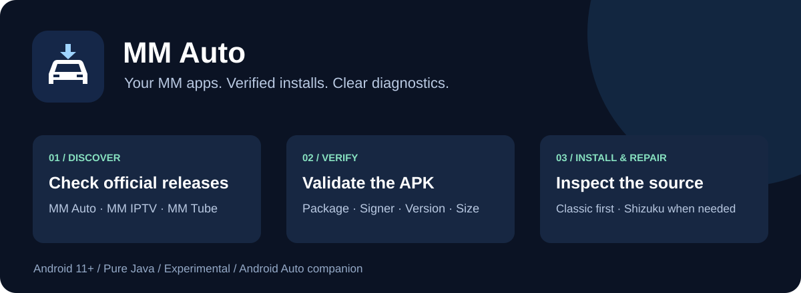

# MM Auto

**Your starting point for MM IPTV and MM Tube on Android Auto.**

[](https://github.com/moustafamagdi/MM-Auto/releases)




Welcome to the official **MM apps hub**, maintained by [moustafamagdi](https://github.com/moustafamagdi). Start here to discover **MM IPTV** and **MM Tube**, find their official downloads, and set them up for your Android Auto environment. **MM Auto** is the companion app that installs, updates and repairs their install-source attribution on Android 11 and later.

**[Download signed APKs](https://github.com/moustafamagdi/MM-Auto/releases) · [Getting started](#getting-started) · [Troubleshooting](docs/TROUBLESHOOTING.md) · [Report a problem](https://github.com/moustafamagdi/MM-Auto/issues/new/choose)**

## Explore the apps

| | **MM IPTV** | **MM Tube** |
| --- | --- | --- |
| On your phone | IPTV player for your own Xtream subscription or M3U playlist, with favorites and playback history. | YouTube viewing through Android WebView, with search, fullscreen and optional sign-in. |
| Android Auto | Experimental projection and a separate audio-control entry for content selected in the app. | Experimental projection and a separate audio-control entry for existing playback. |
| Get the app | **[Download MM IPTV](https://github.com/moustafamagdi/MagdiIPTV/releases)** | **[Download MM Tube](https://github.com/moustafamagdi/MagdiTube/releases)** |
| Learn more | [Source, setup and support](https://github.com/moustafamagdi/MagdiIPTV) | [Source, setup and support](https://github.com/moustafamagdi/MagdiTube) |

**Start with [MM Auto](https://github.com/moustafamagdi/MM-Auto/releases)** to manage both apps together. You can also visit each app's repository above for its own setup instructions and troubleshooting. MM Auto is the installation and maintenance hub; content browsing and playback happen in the individual apps.

> **Experimental software.** Install-source attribution is one part of Android Auto compatibility. A matching install-source pair in Diagnostics does not guarantee visibility or playback. This independent project is not affiliated with Google, Android Auto or Shizuku.

## What MM Auto handles for you

- **Discover updates** from the official GitHub repositories, including compatible preview filenames.
- **Verify APKs** before installation: package, pinned signing certificate, size, checksum when supplied by GitHub, and version code. Reject private initial-account assets.
- **Use a simpler home screen** with Install, Update or Open, Arabic/English, RTL and light/dark appearance.
- **Import an APK manually** from an app’s overflow menu when GitHub checks are unavailable. The same package, signer and version verifier is used.
- **Choose Classic, Shizuku or Root** in Settings → Advanced settings; the existing choice is preserved.
- **Repair existing installations** by reinstalling the exact installed version without uninstalling or clearing app data. The repair operation uses a verified local copy, without a GitHub download.
- **Inspect Diagnostics** for versions, installer attribution and Shizuku availability.
- **Enable daily update alerts** for scheduled background checks when Android allows them.

## Supported apps

| App | Package | Official source |
| --- | --- | --- |
| MM Auto | `com.magdi.auto` | [MM-Auto](https://github.com/moustafamagdi/MM-Auto) |
| MM IPTV | `com.magdi.iptv` | [MagdiIPTV](https://github.com/moustafamagdi/MagdiIPTV) |
| MM Tube | `com.magdi.tube` | [MagdiTube](https://github.com/moustafamagdi/MagdiTube) |

MM Auto is designed for these apps, not arbitrary APKs. It does not supply IPTV accounts, playlists or video content.

## Getting started

1. Open [Releases](https://github.com/moustafamagdi/MM-Auto/releases) and download `MM-Auto-<version>.apk`. Current releases are experimental/prereleases. The source ZIP is not an installable app.
2. Install on Android 11 or later. To update an official MM Auto installation, install over it rather than uninstalling it.
3. Open MM Auto and tap **Check for updates**. Existing installation settings remain selected; optional method choices are under **Settings → Advanced settings** in the 0.2.4 source.
4. Tap **Install** or **Update** and follow the permission prompts. After Classic or Shizuku installation, return to MM Auto to verify both install-source fields.
5. Use **⋮ → Help with a problem** for repair and Diagnostics, then test the target app in your Android Auto setup while parked.

The simplified interface supports Arabic/English and light/dark appearance. See [UI changes and validation](docs/UI-REFRESH.md). For manual downloads, open **⋮ → Releases page**, download an APK from Assets, then return to **⋮ → Choose APK**.

For MM Auto itself, discovery considers compatible previews. For IPTV and Tube, a compatible stable release takes priority. **Update** appears only when the selected release is newer than the installed version.

## Installation methods

| Method | Requirements | Behavior |
| --- | --- | --- |
| **Classic** | Allow “Install unknown apps” for MM Auto | Opens Android's installer and requests Play Store attribution. Device behavior varies. |
| **Shizuku** | [Shizuku](https://github.com/RikkaApps/Shizuku) running and permission granted | Opens the real system installer through a Shizuku UserService. Confirm in Android, then return to verify both source fields. No silent `pm install` fallback. |
| **Root** | An existing root setup and `su` permission | Uses the root shell installation path. **Untested**; compatibility is not guaranteed. |

In the 0.2.7 preview, Classic and Shizuku completion checks are read-only. A metadata match requires **Installed by: com.android.vending** together with **Requested by: Google Play or a resolved system package installer**. Shell, missing and third-party initiators do not match. Root keeps its separate existing installation path. See [Shizuku preview details](docs/SHIZUKU-SYSTEM-INSTALLER.md).

## Repair install source

**0.2.13:** [Guided setup](docs/GUIDED-SETUP.md) walks through Shizuku availability,
startup, permission and repair, in Arabic and English. Xiaomi/POCO/Redmi get the
separate Security settings instruction. Use **Help with a problem → Guided setup**
on an app card; the same guide opens after choosing **Use Shizuku** following repair.

For an already installed MM app, you do not need to delete it or wait for a newer version:

1. In the 0.2.4 interface, open **⋮ → Help with a problem → Repair installation** on its card (older versions show **Repair install source** directly).
2. Allow installs from MM Auto if prompted, and complete the **Classic** installer.
3. Return to MM Auto. If both installation-source fields match, repair finishes without Shizuku.
4. Otherwise, choose **Use Shizuku**, **Try Classic again**, or **Cancel**. Shizuku requires permission and separate confirmation; this repair flow does not invoke it automatically.

Repair verifies the installed APK's package, exact version code and pinned signer, enforces a size limit, checks SHA-256 copy integrity, and rejects private account assets. Split APKs are not supported. The repaired app closes during replacement. Cancelling the installer does not count as success; pending verification expires after 30 minutes.

## Tested behavior and limits

The device observations below describe earlier builds. They do **not** validate the new 0.2.7 system-installer Shizuku route; that route still needs physical-device testing.

| Scenario | Status |
| --- | --- |
| Shizuku installation through MM Auto | Verified on Samsung SM-S948B, Android 17/API 37, Shizuku 13.5 running as adb. Tube received Play Store attribution. |
| Cached-download silent reinstall fallback | Verified on that device by starting with incorrect attribution and observing the reinstall success message and corrected source. |
| Classic installation | Correct attribution observed. Retained-data uninstall may preserve attribution, so this does not prove all Classic installs honor the installer extra. |
| Android Auto launcher visibility | Tube and IPTV appeared in a user-provided Desktop Head Unit screenshot. Playback was not verified. |
| Dedicated Classic-first Repair button | Built and unit-tested; end-to-end device validation remains outstanding. |
| Root, Xiaomi/POCO/Redmi and other ROMs | Untested. |
| Self-update/self-repair and settings preservation | Not fully verified. |
| Android Auto video playback | Not verified. |

The original 27-test suite is retained, with additional source-pair, system-installer dispatch, URI-grant and pending-install lifecycle regression tests. Unit tests do not replace device testing.

## Security and privacy

Release installation is restricted to known repositories, allowed HTTPS hosts and the official signing identity. The pinned certificate SHA-256 is:

```text
6d9d30d8f427a6cfc0241831d1e324e684fe2aefda72925c89ef872bf3a5ab65
```

GitHub API checks are unauthenticated. Do not embed a personal access token in the APK. Rate limits can temporarily stop update discovery; uninstalling apps does not resolve them. See [Troubleshooting](docs/TROUBLESHOOTING.md).

Diagnostics includes device/build information and app versions. Review it before sharing. Never post passwords, signing keys, tokens, private account assets or playlists in issues.

## Build and contribute

Use **JDK 17**, **Android SDK API 36**, **build tools 36.0.0** and **minSdk 30**. The app is written in Java.

```sh
git clone https://github.com/moustafamagdi/MM-Auto.git
cd MM-Auto
# Configure sdk.dir in your untracked local.properties first.
./gradlew :app:assembleDebug :app:lintDebug :app:testDebugUnitTest
```

On Windows, use `gradlew.bat`. Debug builds use `com.magdi.auto.debug` and coexist with the signed release; they have a different signing identity.

See [CONTRIBUTING.md](CONTRIBUTING.md) and [the release checklist](docs/RELEASING.md). Use issue templates for reproducible reports.

## License and acknowledgments

No project license has been selected yet. Public visibility alone is not an open-source license; contact the maintainer before reusing or redistributing project code. Dependencies retain their own licenses.

MM Auto uses the [Shizuku API](https://github.com/RikkaApps/Shizuku-API). The overview illustration is an original repository asset based on MM Auto's icon, not an app screenshot.

## Support reports (0.2.8 preview)

Settings now includes Support & diagnostics, an installation Support ID, consent-based sending and deletion. See [privacy, delivery and owner workflow](docs/SUPPORT.md). The existing detailed installation report remains manual-only under Advanced.

## Shared Support ID (0.2.9)

The updated MM apps can show one random Support ID on the same Android profile through MM Auto. Updates preserve data; linking keeps old installation IDs searchable. Consent remains separate per app, with renewed consent for shared-ID reporting. Settings now group secondary troubleshooting tools under Advanced. See [support guide](docs/SUPPORT.md) for setup, privacy, deletion and test limitations.
